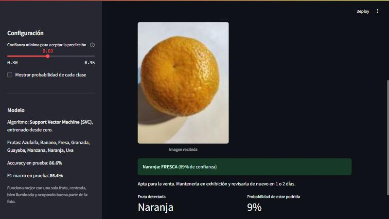
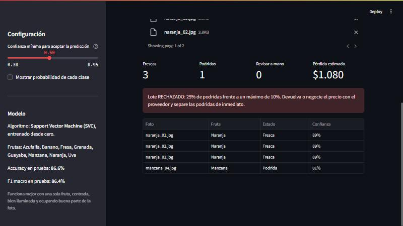

# FrutaCheck: control de calidad de fruta con SVM

Aplicación web que, a partir de una foto, dice **qué fruta es y si está fresca o podrida**, recomienda qué hacer con ella, permite **inspeccionar un lote completo** para decidir si se recibe del proveedor y **detecta varias frutas en una sola foto** para aplicar un descuento a las que están podridas. Usa un modelo **Support Vector Machine (SVM)** entrenado desde cero con fotografías reales. Proyecto de la Actividad 3 de Inteligencia Artificial I, Fundación Universitaria Los Libertadores (Grupo 1).

## Demostración

- Aplicación desplegada: https://frutacheck-grupo1.streamlit.app
- Repositorio: https://github.com/jhonAleVelasco/inteligencia_artificial_trabajoU

| Revisar una fruta | Inspeccionar un lote |
|---|---|
|  |  |

## La necesidad

En Colombia se pierden o desperdician **9,76 millones de toneladas de alimentos al año**, el 34 % de lo disponible, y las **frutas y verduras concentran cerca de 6,1 millones de toneladas** [2]. Buena parte de esa pérdida ocurre antes de llegar al consumidor: en centrales de abasto, plazas de mercado, fruterías y tiendas de barrio.

En esos lugares la calidad se revisa a ojo, y eso trae dos problemas concretos:

1. **Una fruta podrida que se queda en el exhibidor daña a las vecinas** (el moho se propaga y el etileno acelera la maduración), y además aleja a los clientes.
2. **Un lote malo que se recibe sin revisar es dinero perdido**: el tendero paga por fruta que no va a poder vender.

FrutaCheck ataca ambos puntos con la cámara del celular o del computador: detecta la fruta podrida para sacarla a tiempo y resume la calidad de un lote para aceptarlo, rechazarlo o negociar el precio con el proveedor.

**Usuarios:** tenderos, fruteros, encargados de recibo en plazas de mercado y pequeños comercializadores.

## Funcionalidades

- **Revisar una fruta:** foto con la cámara o imagen subida. La app muestra la fruta, si está **fresca o podrida**, la confianza, la probabilidad de que esté podrida y una recomendación (vender o retirar del exhibidor).
- **Inspeccionar un lote:** se suben hasta 60 fotos (una fruta por foto) y se indican el **precio por kg**, el **peso promedio por fruta** y el **máximo de podridas aceptable**. La app cuenta frescas y podridas, estima la **pérdida en pesos** y dice si el lote se **acepta o se rechaza**.
- **Varias frutas por foto:** se ponen varias frutas **separadas** sobre un fondo **liso y claro** y se toma una sola foto. La app encuentra cada fruta, la marca con una caja de color, dice si está fresca o podrida y decide: **vender**, **descuento** (desde 40 % de probabilidad de estar podrida), **retirar** (desde 80 %) o **revisar a mano**. Muestra el precio con y sin descuento de cada fruta y el total.
- **Umbral de confianza ajustable:** si el modelo no está seguro, la app no adivina: pide revisar la fruta a mano.
- **Manejo de errores:** archivos dañados o que no son imágenes, imágenes muy pequeñas y modelo ausente se informan con un mensaje claro, sin que la app se caiga.

## Algoritmo utilizado

**Support Vector Machine** (`sklearn.svm.SVC`) dentro de un pipeline `StandardScaler → SVC`.

**Por qué es apropiado:** cada foto se describe con 1.806 características numéricas de color, textura y forma. El SVM busca la frontera que separa las clases con el **mayor margen** posible [3] y, con el kernel RBF, separa clases que no son linealmente separables. Rinde bien con muchas variables y unos pocos miles de ejemplos, que es este caso. Con `probability=True` entrega la probabilidad de cada clase, que la app usa para el umbral de confianza y para calcular la probabilidad de que la fruta esté podrida.

**Cómo se entrenó** (`notebooks/01_training.ipynb`):

- **Clases:** 16, con la forma `<fruta>_<estado>`: 8 frutas (manzana, banano, naranja, guayaba, fresa, uva, granada y azufaifa), cada una fresca y podrida.
- **División 80 % / 20 % por grupos de casi duplicados:** se calcula una huella perceptual (dHash) de cada foto y las fotos casi idénticas forman un grupo que va completo a entrenamiento o a prueba (`StratifiedGroupKFold`, semilla 42). Así se evita el *data leakage*.
- **Aumento de datos** solo en entrenamiento: cada foto se agrega también en espejo.
- **Búsqueda de hiperparámetros** con `GridSearchCV` y validación cruzada de 3 particiones con los mismos grupos: kernel lineal o RBF, `C`, `gamma` y `class_weight`. La métrica de selección es F1 macro. El modelo final se reentrena con los mejores valores y `probability=True`.
- **Mejores hiperparámetros:** kernel RBF, C = 100, gamma = 0,0001.

**Métricas en el conjunto de prueba** (633 fotos que el modelo no vio):

| Métrica | Valor |
|---|---|
| Accuracy (fruta y estado correctos, 16 clases) | **86,6 %** |
| Precision (macro) | 86,5 % |
| Recall (macro) | 86,4 % |
| F1 (macro) | 86,4 % |
| F1 macro en validación cruzada | 82,6 % |
| Clasificador base (clase más frecuente) | 5,2 % |
| **Fresca vs. podrida** (sin importar la fruta) | **93,4 %** |
| Recall de podridas / precision de podridas | 92,1 % / 94,5 % |
| Fruta correcta (sin importar el estado) | 89,3 % |

Con el umbral por defecto (0,60), la app responde sola en el 81 % de las fotos con 95,3 % de acierto, y el resto lo manda a revisión manual. Las clases más difíciles son manzana podrida (F1 0,73) y granada podrida (0,76), que suelen tener una pudrición incipiente.

## Detección de varias frutas y descuento

El modelo de arriba clasifica **una fruta por foto**. Para una foto con varias frutas separadas sobre un fondo claro se agregó un paso previo (`src/detectar.py`), también sin redes neuronales:

1. **Fondo:** se estima su color con el borde de la foto (mediana en CIELAB). Todo lo que se aleja de ese color es fruta (umbral de Otsu). Las sombras casi no cambian el tono, así que pesan menos que el color.
2. **Una mancha = una fruta:** morfología y componentes conexos. Si una mancha parece dos frutas pegadas, se separa con *watershed* solo cuando entre ellas hay un cuello claro, para no partir un banano curvo.
3. **Recorte:** cada fruta se recorta en un cuadrado con margen y todo lo que no es la fruta (fondo y vecinas) se pinta de gris neutro, de modo que el modelo vea solo la fruta.
4. **Clasificación:** cada recorte pasa por un SVM con las mismas 1.806 características (`models/modelo_deteccion.pkl`).
5. **Decisión por fruta** con la *probabilidad de estar podrida* (la suma de las probabilidades de las 8 clases podridas):

| Probabilidad de podrida | Acción |
|---|---|
| menor a 40 % | Vender a precio normal |
| 40 % o más | **Descuento** (30 % por defecto, ajustable) |
| 80 % o más | **Retirar** del exhibidor |
| la clase más probable no supera la confianza mínima | **Revisar a mano** (salvo que ya sea de las que se retiran, que no necesitan saber qué fruta es) |

Los umbrales y el descuento se ajustan en la app. Ojo: es la **probabilidad que da el modelo**, no el porcentaje de la superficie de la fruta que está dañada.

**Por qué un segundo modelo.** `modelo.pkl` se entrenó con fotos completas, donde la fruta llena el cuadro. Con recortes pierde casi toda su precisión (13 % de acierto en 16 clases sobre los recortes de prueba). Por eso `src/entrenar_deteccion.py` entrena el mismo SVM (kernel RBF, C = 100, gamma = 0,0001) con los recortes que produce el detector, usando **la misma división entrenamiento/prueba** del notebook: ningún recorte de prueba viene de una foto vista al entrenar. El modelo de la pestaña "Revisar una fruta" no cambia.

**Resultados**

| Evaluación | 16 clases | Fruta | Fresca vs. podrida |
|---|---|---|---|
| Recortes de las fotos de prueba (728 recortes) | 80,1 % | 85,7 % | 89,6 % |
| Escenas armadas con varias frutas (4 series de 40 escenas) | 74-87 % | 77-93 % | 90-92 % |

En las escenas armadas no hubo detecciones falsas ni frutas perdidas; las podridas que pasaron como normales fueron entre 0 y 2 por serie (de unas 90), y las frescas marcadas por error con descuento o retiro, entre 1 y 4 (de unas 85). Con ellas, el modelo original da 14 % en 16 clases y marca como podrida casi todo.

**Cómo se evaluó y qué no demuestra.** No hay fotos reales con varias frutas etiquetadas, así que `src/evaluar_deteccion.py` fabrica escenas con fotos del conjunto de prueba: recorta cada fruta con GrabCut (un algoritmo distinto al del detector) y las pega separadas sobre un fondo claro liso con sombra suave. Es una aproximación: los bordes recortados y el fondo perfectamente liso no son los de una foto real. **Hay que validar con fotos propias** antes de dar estas cifras como definitivas.

```bash
pip install -r requirements-captura.txt    # trae opencv, que usa la evaluación
python -m src.evaluar_deteccion --escenas 40 --guardar escenas_prueba
```

**Para que funcione bien:** fondo liso y claro (no hace falta que sea blanco), frutas separadas entre sí, foto de frente y con buena luz. Puede fallar con fondos con dibujos, frutas del mismo color del fondo, sombras muy duras, frutas que se montan unas sobre otras o racimos (una uva suelta y un racimo se cuentan distinto).

## Dataset

- **Fuente:** *Fresh and Rotten Fruits Dataset for Machine-Based Evaluation of Fruit Quality* [1], Mendeley Data, **licencia CC BY 4.0**. Son fotografías **reales** tomadas en fruterías y en campo, y un experto de un instituto agrícola clasificó cada fruta como fresca o podrida.
- **Tamaño:** 3.200 imágenes originales, 200 por clase (1.600 frescas y 1.600 podridas). Se quitaron 7 duplicados exactos y quedaron 3.193. Las imágenes aumentadas que trae el dataset **no se usan**.
- **Preparación:** `src/preparar_datos.py` traduce las carpetas del dataset (`FreshApple`, `RottenBanana`, ...) a `data/raw/<fruta>_<estado>/` y reduce cada foto a 256 píxeles por el lado corto (unos 53 MB en total).
- **Features** (calculadas en `src/preprocessing.py` sobre la foto recortada al cuadrado central y reducida a 128 × 128 píxeles):
  - **Histogramas HSV** (32 valores): tono, saturación y brillo. La fruta podrida suele ser más oscura y menos saturada.
  - **LBP uniforme** (10 valores) [4]: textura de la cáscara, sensible a manchas, arrugas y moho.
  - **HOG** (1.764 valores) [5]: dirección de los bordes en cada zona, es decir, la forma de la fruta.

**No se usan modelos pre-entrenados ni redes neuronales:** las características se calculan con fórmulas fijas y el SVM se entrena desde cero.

## Instalación local

### Requisitos

- Python 3.12 (también funciona con 3.11)
- pip
- Una cámara web, si se quiere usar la cámara en la app

### Pasos

```bash
git clone https://github.com/jhonAleVelasco/inteligencia_artificial_trabajoU.git
cd inteligencia_artificial_trabajoU
python -m venv .venv
# Windows: .venv\Scripts\activate    |    macOS/Linux: source .venv/bin/activate
pip install -r requirements.txt
```

### Ejecutar la aplicación

```bash
streamlit run app/app.py
```

Se abre en http://localhost:8501.

### Con Docker

```bash
docker build -t frutacheck .
docker run -p 8501:8501 frutacheck
```

### Panel de calidad (React + API)

Interfaz rediseñada para computador con dos secciones: **Revisar fruta** (una foto con una o varias frutas: caja y precio sobre cada una, tabla, medidor de riesgo y reglas de descuento que se ajustan al instante) y **Precios** (precio por unidad de cada fruta). Usa los mismos modelos; la app de Streamlit sigue disponible.

```bash
pip install -r requirements-api.txt
cd web
npm install
npm run build
cd ..
python -m uvicorn api.main:app --port 8000
```

Se abre en http://localhost:8000. Para trabajar en el diseño con recarga en vivo, deje la API en el puerto 8000 y ejecute `npm run dev` dentro de `web/` (http://localhost:5173).

Con Docker: `docker build -f Dockerfile.panel -t frutacheck-panel .` y `docker run -p 8000:8000 frutacheck-panel`.

Pruebas: `pip install -r requirements-dev.txt`, luego `pytest` (modelo, detección y API) y `npm test` dentro de `web/` (reglas de descuento).

### Volver a entrenar el modelo

1. **Opcional**, para regenerar `data/raw/` desde el dataset original: descargar `Original Image.zip` de https://data.mendeley.com/datasets/bdd69gyhv8/1, descomprimirlo y ejecutar:
   ```bash
   python src/preparar_datos.py --origen "RUTA/Original Image" --limpiar
   ```
2. **Opcional**, para agregar fotos propias de una tienda (requiere `pip install -r requirements-captura.txt`):
   ```bash
   python src/capturar_fotos.py --clase manzana_podrida --n 120
   ```
3. Abrir `notebooks/01_training.ipynb` y ejecutarlo completo (unos 12 minutos). Al final genera `models/modelo.pkl` y `models/metadata.json`.
4. Para el modelo de varias frutas por foto (unos 5 minutos), desde la raíz: `python -m src.entrenar_deteccion`. Genera `models/modelo_deteccion.pkl` y `models/metadata_deteccion.json`. Con `--buscar` también busca C y gamma por validación cruzada.

## Uso

1. Abra la aplicación y, si va a usar la cámara, permita el acceso.
2. **Revisar una fruta:** ponga **una sola fruta** en el centro de la imagen, con buena luz, y tome la foto o suba una imagen. Si sale *podrida*, retírela del exhibidor.
3. **Inspeccionar un lote:** ingrese el precio por kg, el peso promedio por fruta y el máximo de podridas que acepta. Luego suba las fotos del lote y revise el resumen y la tabla.
4. En la barra lateral se ajusta la confianza mínima y se ve el desempeño del modelo.

## Estructura del proyecto

```
inteligencia_artificial_trabajoU/
├── README.md                  Documentación principal
├── requirements.txt           Dependencias de la app y del notebook
├── requirements-captura.txt   Dependencia extra para tomar fotos (OpenCV)
├── requirements-api.txt       Dependencias mínimas de la API del panel
├── Dockerfile                 Imagen de la app Streamlit
├── Dockerfile.panel           Imagen del panel React + API
├── .gitignore / .dockerignore
├── LICENSE
├── data/
│   ├── raw/<fruta>_<estado>/  Fotos del dataset, una carpeta por clase (16)
│   └── processed/             caracteristicas.csv (lo genera el notebook; no se sube)
├── notebooks/
│   └── 01_training.ipynb      EDA, preprocesamiento, entrenamiento, evaluación y serialización
├── models/
│   ├── modelo.pkl             Pipeline entrenado (StandardScaler + SVC)
│   ├── metadata.json          Clases, hiperparámetros, métricas y versiones
│   ├── modelo_deteccion.pkl   Mismo SVM entrenado con recortes (varias frutas por foto)
│   └── metadata_deteccion.json
├── src/
│   ├── __init__.py
│   ├── preprocessing.py       Carga de imágenes y extracción de características
│   ├── predict.py             Carga del modelo, predicción y resumen de lote
│   ├── detectar.py            Varias frutas por foto: segmentación, recortes, descuento
│   ├── entrenar_deteccion.py  Entrena models/modelo_deteccion.pkl con recortes
│   ├── evaluar_deteccion.py   Evalúa la detección con escenas armadas
│   ├── preparar_datos.py      Convierte el dataset original a data/raw
│   └── capturar_fotos.py      Captura de fotos propias con la cámara
├── app/
│   ├── app.py                 Aplicación Streamlit
│   └── static/
├── api/
│   └── main.py                API FastAPI (/api/revisar) que también sirve el panel
├── web/                       Panel de calidad (React + Vite + TypeScript)
│   ├── src/                   Vistas, componentes, reglas de descuento y estilos
│   └── public/ejemplos/       Fotos de ejemplo para probar sin subir nada
└── docs/
    ├── captura_*.jpg          Capturas de la app
    └── presentacion.pdf       Presentación final
```

## Arquitectura

```
ENTRENAMIENTO (una vez)                           USO (cada foto)
data/raw ──► preprocessing.py ──► notebook ──►    Usuario (cámara / fotos)
              (HSV + LBP + HOG)   (GridSearch      │
                                   + SVM)          ▼
                                      │         app/app.py (Streamlit)
                                      ▼            │
                               models/modelo.pkl ─►src/predict.py ──► resultado
                                                    (usa preprocessing.py)
```

## Despliegue

El panel React necesita un servicio que ejecute contenedores (por ejemplo Azure Container Apps o Render) con `Dockerfile.panel`; Streamlit Community Cloud no lo aloja. La app de Streamlit se despliega así:

Servicio: **Streamlit Community Cloud**. En https://share.streamlit.io se conecta este repositorio y se eligen la rama `main`, el archivo principal `app/app.py` y Python 3.12. La plataforma instala `requirements.txt` y publica la URL. La cámara funciona desde el navegador del usuario, así que no hay que instalar nada. El modelo (unos 35 MB) carga en unos 4 segundos.

## Limitaciones y trabajo futuro

- El modelo solo conoce estas 8 frutas; otra fruta siempre se parecerá a alguna. Por eso la app usa un umbral de confianza.
- Las fotos del dataset vienen de fruterías de Bangladés. La luz y el fondo de otra tienda pueden bajar el desempeño, y en las pestañas de una sola fruta una foto con varias frutas mezcladas confunde al modelo (para eso está "Varias frutas por foto", con frutas separadas y fondo claro).
- **Trabajo futuro:** fotos propias de tiendas colombianas y frutas locales (mango, lulo, mora, aguacate); un nivel intermedio "madura, vender pronto"; detección de frutas montadas unas sobre otras o en racimos, y validación con fotos reales de tiendas; porcentaje de superficie dañada por fruta; historial de lotes por proveedor.

## Referencias

[1] N. Sultana, M. Jahan y M. S. Uddin, "Fresh and Rotten Fruits Dataset for Machine-Based Evaluation of Fruit Quality," Mendeley Data, v1, 2022, doi: 10.17632/bdd69gyhv8.1.
[2] Departamento Nacional de Planeación (DNP), "Pérdida y desperdicio de alimentos en Colombia," Bogotá, 2016.
[3] C. Cortes y V. Vapnik, "Support-vector networks," *Machine Learning*, vol. 20, no. 3, pp. 273–297, 1995.
[4] T. Ojala, M. Pietikäinen y T. Mäenpää, "Multiresolution gray-scale and rotation invariant texture classification with local binary patterns," *IEEE Trans. Pattern Anal. Mach. Intell.*, vol. 24, no. 7, pp. 971–987, 2002.
[5] N. Dalal y B. Triggs, "Histograms of oriented gradients for human detection," en *Proc. IEEE CVPR*, 2005, pp. 886–893.

## Autores

- Jhon Alejandro Velasco García: repositorio, aplicación web y despliegue
- Keiner Astos: datos, preprocesamiento y entrenamiento del modelo
- Yesid Esteban Avendaño Barbosa: predicción, pruebas y documentación

## Licencia

Código bajo licencia MIT (ver `LICENSE`). Las imágenes de `data/raw/` pertenecen a sus autores [1] y se usan bajo CC BY 4.0.
